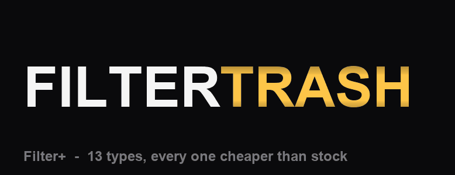

# Filter+

Per-track filter modes for the **Digitakt mk1 (OS 1.54)** and
**Digitone mk1 / Digitone Keys (OS 1.44)**. Filter+ adds 13 filter types, all
cheaper than the stock Elektron filter types, while using each voice's own
FREQ, RESO and filter envelope.

| device | TYPE | modes |
|---|---|---|
| Digitakt | 8..20 | **BP**, **BP2**, **COMB**, **TRASH**, **LP1**, **HP1**, **LP4-**, **HP4-**, **LP2**, **HP2**, **NOTCH**, **COMB-**, **TRASH-** |
| Digitone | 4..16 | **BP**, **BP2**, **COMB**, **TRASH**, **LP1**, **HP1**, **LP4-**, **HP4-**, **LP2**, **HP2**, **NOTCH**, **COMB-**, **TRASH-** |

Stock TYPE values keep running the stock filter. The FLTR page redraws its
FREQ/RES response curve and TYPE-box icon for the new modes; the icon is a
smooth response curve with its pole order (1, 2 or 4).



*FILTER stays fixed while the 13 type names scroll through.*

- Both machines: COMB/TRASH use HARM/DAMP on the second FLTR page's free
  encoders.
- The low-CPU bank: LP1/HP1 are 1-pole, LP4-/HP4- are four cascaded 1-poles,
  LP2/HP2/NOTCH use the shared SVF core, and COMB-/TRASH- are integer-delay
  combs with no fractional read or damping.
- BP/BP2 are the original state-variable band-pass modes; COMB/TRASH are the
  full-featured feedback combs.

> **Note:** Using multiple COMB / TRASH filters will slow down your machine,
> especially poly tracks on the Digitone. Watch and manage your levels when
> adjusting and/or changing filter types.

## CPU

Cycles per voice per 32-sample block, measured on the Digitakt adapter with
`tests/df_bench.py` (digiemu cycle model). The DSP kernels are shared with the
Digitone. The stock row is the measured stock multimode filter on DT 1.53;
per-TYPE stock costs were not separately benched.

| rank | TYPE | static cycles | vs stock (static / swept) | swept cycles |
|---:|---|---:|---:|---:|
| — | **Stock multimode** (LP2 / HP / LP4 / EQ) | **2603** | **100% / 100%** | **2603** |
| — | —————————————— | —: | —: | —: |
| 1 | **LP1** | 606 | 23% / 23% | 593 |
| 2 | **HP1** | 671 | 26% / 26% | 665 |
| 3 | **TRASH-** | 1035 | 40% / 40% | 1035 |
| 4 | **COMB-** | 1072 | 41% / 40% | 1044 |
| 5 | **BP2** | 1318 | 51% / 88% | 2294 |
| 6 | **BP** | 1346 | 52% / 91% | 2363 |
| 7 | **NOTCH** | 1465 | 56% / 92% | 2403 |
| 8 | **HP2** | 1480 | 57% / 93% | 2423 |
| 9 | **LP2** | 1481 | 57% / 93% | 2421 |
| 10 | **LP4-** | 1562 | 60% / 60% | 1556 |
| 11 | **HP4-** | 1633 | 63% / 62% | 1626 |
| 12 | **TRASH** | 2023 | 78% / 78% | 2022 |
| 13 | **COMB** | 2037 | 78% / 78% | 2022 |

Worst-case (swept) ranking: LP1 → HP1 → TRASH- → COMB- → LP4- → HP4- → TRASH
→ COMB → BP2 → BP → NOTCH → LP2 → HP2.

## Device notes

- [Digitakt mk1 - Filter+](filterplus-dt/README.md)
- [Digitone mk1 / Keys - Filter+ DN](filterplus-dn/README.md)

## Testing

```sh
# Digitakt DSP
python tests/filter_model.py
python tests/comb_equivalence.py
python tests/df_bench.py          # needs digiemu's patched Unicorn

# Digitone: builds and runs the shared Filter+ DSP on the host
python tests/df_bench.py          # needs digiemu's patched Unicorn
```

See the device READMEs and `docs/` for the emulator and hardware checks.

## Credits

- **Digital Alchemy DSP** - the Filter+ modes, DSP and FLTR-page drawing.
- **x2k_77-m1** - the original Digitone port and TYPE icons.

## Licence

GPL-2.0-or-later. No Elektron firmware is included or committed.
